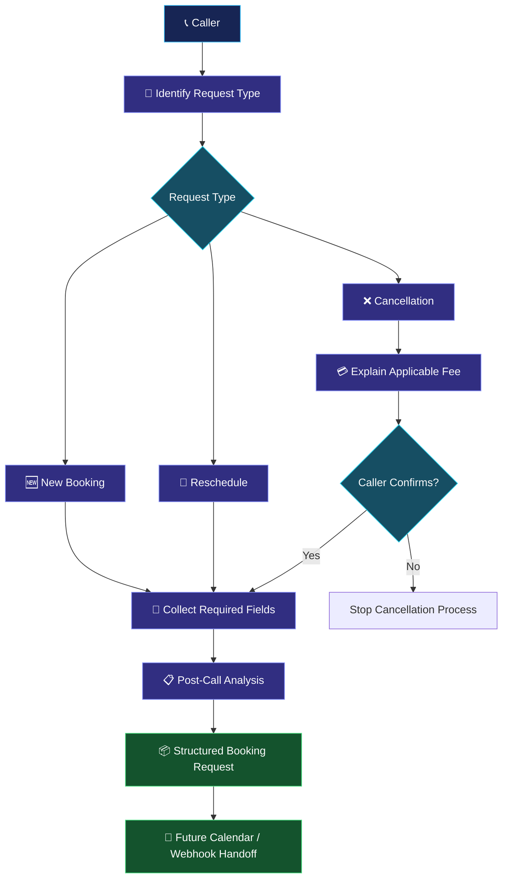

<div align="center">


# 🏡 NovaNest Consultation Booking Agent

### Collect the request. Respect the rules. Never promise an unverified slot.

A Retell AI voice agent that collects booking requests, never promises a slot, and hands off a clean structured request.

<a href="https://www.loom.com/share/d7a16178b492428ba0942ea2fdb25e23"></a>
&nbsp;
<a href="prompt/agent_prompt.md"></a>
&nbsp;
<a href="tests/test_results.md"></a>
&nbsp;
<a href="post-call-analysis/pca_fields.md"></a>

<br/>


**Retell AI · Topic 6 · Appointment Booking Logic & Calendar Handoff Design**

[🎬 Loom Demo](https://www.loom.com/share/d7a16178b492428ba0942ea2fdb25e23) · [📂 Repository](https://github.com/shaikshahid777/novanest-booking-agent) · [👤 GitHub Profile](https://github.com/shaikshahid777)

</div>

---

## 📑 Table of Contents

- [📖 About the Project](#-about-the-project)
- [✨ Key Features](#-key-features)
- [⚙️ How It Works](#️-how-it-works)
- [🗓️ Scheduling Rules](#️-scheduling-rules)
- [💳 Cancellation and Rescheduling Policy](#-cancellation-and-rescheduling-policy)
- [🛡️ Availability Language Control](#️-availability-language-control)
- [📋 Post-Call Analysis Schema](#-post-call-analysis-schema)
- [🧪 Testing and Validation](#-testing-and-validation)
- [🧰 Technology Stack](#-technology-stack)
- [📁 Repository Structure](#-repository-structure)
- [🚀 Future Enhancements](#-future-enhancements)
- [👨‍💻 Author](#-author)

---

## 📖 About the Project

**NovaNest Consultation Booking Agent** is an inbound voice agent built with **Retell AI's Single Prompt Agent** for **Retell AI Topic 6 — Appointment Booking Logic & Calendar Handoff Design**.

It helps callers submit consultation requests for NovaNest Real Estate. The agent identifies the request type, gathers caller details and preferred time windows, follows the configured scheduling rules, and organizes the conversation into structured Post-Call Analysis output.

> **Core principle:** Collect preferences, never promise a slot, and hand off a clean structured request.

This assessment uses Retell's dashboard **Test** button. The agent does **not** connect to a live calendar, verify real-time availability, or create calendar events.

## ✨ Key Features

<table>
<tr>
<td width="50%">

### 🎙️ Inbound Voice AI
Warm, professional conversational flow for consultation requests.

</td>
<td width="50%">

### 🧭 Three Request Paths
Handles **New Booking**, **Reschedule**, and **Cancellation**.

</td>
</tr>
<tr>
<td>

### 🗓️ Scheduling Guardrails
Business hours, 45-minute duration, 24-hour notice, and 30-day booking horizon.

</td>
<td>

### 🌎 Timezone-Aware Preferences
Clarifies timezone and records each preferred window with an explicit timezone.

</td>
</tr>
<tr>
<td>

### 🛡️ No False Availability Claims
Does not promise a time slot is available, confirmed, booked, or secured.

</td>
<td>

### 📋 Structured Post-Call Data
Extracts 12 fields for consistent handoff to a booking workflow.

</td>
</tr>
<tr>
<td>

### 💳 Policy-Aware Fee Handling
Explains the applicable cancellation or rescheduling fee before proceeding.

</td>
<td>

### 🔌 Calendar Handoff Design
Prepares structured data for a future calendar API or webhook integration.

</td>
</tr>
</table>

## ⚙️ How It Works



1. **Identify intent** — New booking, rescheduling, or cancellation.
2. **Collect details** — Contact information, service type, and up to three preferred windows.
3. **Apply rules** — Enforce scheduling constraints and explain the applicable fee before proceeding.
4. **Extract data** — Organize the conversation into 12 Post-Call Analysis fields.
5. **Prepare the handoff** — Produce a structured request without claiming that a reservation has been made.

## 🗓️ Scheduling Rules

| Rule | Configured Value | Expected Behavior |
|---|---|---|
| Business hours | Monday–Friday, 9:00 AM–6:00 PM CT | Do not accept requests outside configured hours |
| Consultation duration | 45 minutes | Collect preferences for the required duration |
| Latest start time | 5:15 PM CT | Keep the 45-minute consultation within business hours |
| Buffer | 15 minutes | Handled by the calendar system, not the agent |
| Business timezone | Central Time — America/Chicago | Anchor windows with an explicit timezone |
| Advance notice | At least 24 hours | Do not proceed with same-day booking requests |
| Booking horizon | Up to 30 days ahead | Reject preferences beyond the allowed horizon |
| Preferred windows | Maximum of 3 | Record each preference separately |
| Availability verification | No live calendar | Record preferences only; never promise a slot |

## 💳 Cancellation and Rescheduling Policy

| Request | Configured Policy | Agent Behavior |
|---|---|---|
| Cancellation within 24 hours | $50 fee | Explain the fee and obtain consent before proceeding |
| Rescheduling within 4 hours | $50 fee on the original booking | Explain the fee before proceeding |
| Caller declines | Do not continue the action | Respect the caller's decision |
| Existing appointment | Capture original booking reference | Include it in the structured request |

Cancellation and rescheduling are distinct paths. Do not apply one policy to the other unless the configured instructions explicitly require it.

## 🛡️ Availability Language Control

Because there is no live calendar integration, the agent must not make unsupported promises about appointment status.

| ❌ Wrong | ✅ Right |
|---|---|
| “Tuesday at 2 PM is available.” | “I've noted Tuesday at 2 PM CT as your first preference.” |
| “Your consultation is confirmed.” | “I've recorded your consultation request for the team to review.” |
| “Your appointment is booked and secured.” | “Your preferred time has been included in your booking request.” |

**Critical rule:** Never use “available,” “confirmed,” “booked,” or “secured” to claim that a specific time slot is reserved. Use **noted**, **recorded**, and **requested** instead.

## 📋 Post-Call Analysis Schema

The agent extracts **12 fields**. `service_type` and `request_type` are Selector fields; the remaining ten fields are Text.

| # | Field | Type | Purpose |
|---:|---|---|---|
| 1 | `caller_first_name` | Text | First name as confirmed during the call |
| 2 | `caller_last_name` | Text | Last name with confirmed spelling |
| 3 | `caller_phone` | Text | Confirmed 10-digit phone number |
| 4 | `caller_email` | Text | Email address confirmed by spelling |
| 5 | `service_type` | Selector | Buyer Consultation, Seller Consultation, or Investment Review |
| 6 | `preferred_window_1` | Text | First preferred window including timezone |
| 7 | `preferred_window_2` | Text | Second preferred window including timezone |
| 8 | `preferred_window_3` | Text | Third preferred window including timezone |
| 9 | `caller_timezone` | Text | Caller timezone when different from CT |
| 10 | `booking_notes` | Text | Additional preferences or context |
| 11 | `request_type` | Selector | New, Reschedule, or Cancellation |
| 12 | `original_booking_reference` | Text | Original date/time or reference for an existing appointment |

- Optional fields may remain empty when not applicable.
- Do not invent missing caller details.
- Preserve the date, time, and timezone for each preferred window.
- Contact fields are not automatically saved to contact fields in the current configuration.

**Field reference:** [`post-call-analysis/pca_fields.md`](post-call-analysis/pca_fields.md)  
**Sample output:** [`post-call-analysis/sample_booking_request.json`](post-call-analysis/sample_booking_request.json)

## 🧪 Testing and Validation

Tests are run using the Retell AI dashboard's **Test** button. After each call, inspect the transcript and extracted fields in Call History.

| Test | Scenario | What to Verify |
|---|---|---|
| 1 | New buyer consultation | Caller details and three preferred windows are captured |
| 2 | Cross-timezone seller consultation | ET is clarified and recorded in the preferred window and timezone field |
| 3 | Cancellation within 24 hours | $50 fee is stated before cancellation proceeds |
| 4 | Same-day request | The 24-hour rule is explained and booking does not continue |
| 5 | Language audit | Restricted availability claims do not appear in the agent's lines |

The [test results file](tests/test_results.md) contains the review checklist and screenshot references. Record the actual outcome after reviewing each call; do not mark a test as passed until its evidence has been checked.

### Validation checklist

- [ ] New booking flow reviewed.
- [ ] All three preferred windows captured.
- [ ] Timezone clarification verified.
- [ ] Cancellation fee explained before consent.
- [ ] Same-day request disqualified.
- [ ] All 12 extraction fields reviewed.
- [ ] Transcript checked for restricted availability claims.

## 🧰 Technology Stack

<div align="center">


</div>

| Technology | Purpose |
|---|---|
| Retell AI | Voice agent platform |
| Single Prompt Agent | Conversation rules and intent handling |
| Post-Call Analysis | Structured extraction of the 12 fields |
| Prompt Engineering | Scheduling guardrails, policy logic, and safe wording |
| Mermaid | Visual workflow documentation |
| GitHub | Versioned project files and test documentation |

## 📁 Repository Structure

```text
novanest-booking-agent/
├── prompt/
│   └── agent_prompt.md
├── post-call-analysis/
│   ├── pca_fields.md
│   └── sample_booking_request.json
├── tests/
│   ├── test_cases.md
│   └── test_results.md
├── screenshots/
└── README.md
```

### Quick links

- 🧠 [Agent prompt](prompt/agent_prompt.md)
- 📋 [Post-Call Analysis fields](post-call-analysis/pca_fields.md)
- 📦 [Sample booking request](post-call-analysis/sample_booking_request.json)
- 🧪 [Test cases](tests/test_cases.md)
- 📊 [Test results and review checklist](tests/test_results.md)
- 🎬 [Loom demo](https://www.loom.com/share/d7a16178b492428ba0942ea2fdb25e23)

## 🚀 Future Enhancements

The current assessment is a **calendar handoff design**, not a live booking integration.

- 🔌 Connect a calendar API through a Retell custom function or webhook.
- 📅 Verify real-time availability before offering an actual slot.
- 🗓️ Create or update calendar events only after a successful availability check.
- ✉️ Send email or SMS confirmations after the calendar system confirms the event.
- 🧪 Add automated validation for date ranges, business hours, and timezone conversion.
- 📊 Track handoff outcomes and expand regression testing.

A final booking confirmation should only be sent after a connected calendar system verifies and successfully creates the appointment.

## 👨‍💻 Author

<div align="center">

### Shaik Mohammad Shaheed

AI & Automation · Voice AI · Prompt Engineering

<a href="https://github.com/shaikshahid777"></a>
&nbsp;
<a href="https://www.loom.com/share/d7a16178b492428ba0942ea2fdb25e23"></a>

</div>

---

<div align="center">

**NovaNest Consultation Booking Agent**

<sub>Retell AI Topic 6 — Appointment Booking Logic & Calendar Handoff Design</sub>

<br/>

<a href="https://www.loom.com/share/d7a16178b492428ba0942ea2fdb25e23"></a>

</div>
